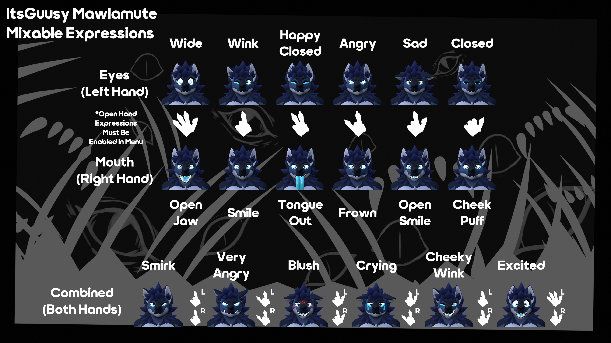

# Mawlamute Avatar

> [!Important]
> This is a WIP.

<!-- markdownlint-disable MD033 -->

<!-- panels:start -->

<!-- div:title-panel -->

## Credits

<!-- div:right-panel -->

`v1.0-R1.0`

- Avatar Import: **Axiom Wolf**
- Coordination and Docs: **Phil**

<!-- div:left-panel -->

[CommunityPortNotice](winterbold-avatar.md#CommunityPortNotice ':include')

<!-- panels:end -->

## Use Guide

### Basic Setup

To start using the Mawlamute right away without any customizations, hold the "Finish Avatar" button. Thats it!

### Custom Textures

1. Import your textures to Resonite by dragging and dropping the files into the game.
1. Switch to the "Textures"-tab
1. Hold the texture with one hand
1. Primary click on the texture you want to replace

On Desktop, you need to laser-grab with holding left-click and right-click on the texture you want to replace.

### Core Add-On

The Mawlamute Core add-on comes pre-installed with the avatar and is fully customizable through the context menu. This allows for expressions, based on the VRC hand-gestures and community made addons.

### Improving Avatar Performance

- You can improve performance by disabling addon-features are you don't need.
- It is recommended for knowledgeable users to bake any unused blendshapes to greatly reduce load times for the avatar. The body's mesh is located in `/CenteredRoot/Renderers/Body`. Keep in mind that this may limit the ability to add clothing options in the future.
- By default textures have a 4K resolution, and can be downscaled through the Asset Optimization Wizard, available from the dev tool. This saves on inventory space and reduces memory usage.

<!-- panels:start -->

<!-- div:title-panel -->

### Controls

<!-- div:left-panel -->

#### VR Controls

<!-- div:right-panel -->

#### Desktop controls

- <kbd>Keypad0</kbd>: Eyes Wide
- <kbd>Keypad1</kbd>: Eyes Happy (Closed)
- <kbd>Keypad2</kbd>: Wink
- <kbd>Keypad3</kbd>: Eyes Sad
- <kbd>Keypad4</kbd>: Eyes Closed
- <kbd>Keypad5</kbd>: -
- <kbd>Keypad6</kbd>: Eyes Angry
- <kbd>Keypad7</kbd>: Mouth Open
- <kbd>Keypad8</kbd>: Tongue Out
- <kbd>Keypad9</kbd>: Smile
- <kbd>KeypadDivide</kbd>: Open Smile
- <kbd>KeypadMultiply</kbd>: Cheek Puff
- <kbd>KeypadMinus</kbd>: -
- <kbd>KeypadPlus</kbd>: Frown

<!-- panels:end -->

## Technical Documentation

This avatar follows the [Avatar Standard](https://wiki.resonite.com/Avatar_standard) (up to spec as of November 2026).

Most expression and personalization functionality is self-contained in the Core Add-On. It is possible to uninstall and re-install this system at any time. The avatar contains several DynamicValueVariableDrivers that listen to values set by this module.

### Non-Standardized variables

### Avatar Specific Variables

These blendshapes trigger custom effects on the avatar. These variables are only provided by the core addon. However, variables marked with `◂` are listened to as drivers.

#### Tail

#### Toes

#### Ears

#### Headpats

#### Eyes

#### Expressions

#### Tongue

#### Body

#### Clothing

### Blendshapes

Only a subset of Blendshapes are available as dynamic variables. The rest can be either reserved or baked for performance. Keep in mind that some may be used in the future for clothes compatibility.

## TEMP LIST

> [!Note]
> This list will be ordered into categories later. It is also still missing the write back (`◂`) notice.

- bool `CheekSquish.Enabled`
- bool `Clothing.TechTrash.Boots`
- string `Clothing.TechTrash.Boots`
- bool `Clothing.TechTrash.Jacket`
- string `Clothing.TechTrash.Jacket`
- bool `Clothing.TechTrash.Leggings`
- string `Clothing.TechTrash.Leggings`
- bool `Clothing.TechTrash.Shorts`
- string `Clothing.TechTrash.Shorts`
- bool `Clothing.TechTrash.Stockings`
- string `Clothing.TechTrash.Stockings`
- bool `Clothing.TechTrash.Undershirt`
- string `Clothing.TechTrash.Undershirt`
- bool `DynamicBoneChain.Breasts.Enabled`
- bool `DynamicBoneChain.Butt.Enabled`
- bool `DynamicBoneChain.Toes.Enabled`
- bool `DynamicBoneChain.Tummy.Enabled`
- float `Emote.Ear.Back.L`
- float `Emote.Ear.Back.R`
- float `Emote.Ear.Deflect.L`
- float `Emote.Ear.Deflect.R`
- float `Emote.Tongue`
- bool `Expression.Active`
- float? `Expression.LightconeTarget`
- bool `Expressions.DoOpenHandExpressions`
- bool `Expressions.Eyes.Enable`
- bool `Expressions.Eyes.Lock`
- bool `Expressions.Mouth.DoOpenHandExpressions`
- bool `Expressions.Mouth.Enable`
- bool `Expressions.Mouth.Lock`
- bool `EyeManager.DisableBlinking`
- float `EyeManager.EyeCloseOverride.Left`
- float `EyeManager.EyeCloseOverride.Right`
- float `EyeManager.EyesClosed.Left.Result`
- float `EyeManager.EyesClosed.Right.Result`
- bool `EyePoke.Enabled`
- bool `Face.Blinking`
- bool `FT.LongTongue`
- byte `HandGestures.Fingers.Left`
- byte `HandGestures.Fingers.Right`
- int `HandGestures.Gesture.Left`
- int `HandGestures.Gesture.Right`
- bool `Headpats.Enabled`
- bool `Headpats.LocalTrigger`
- bool `Headpats.Sound.Enabled`
- bool `Headpats.Trigger`
- float? `LocomotionAnimationFeetMetrics.FootHeight`
- IAssetProvider\`1[Material] `Material.Body`
- IAssetProvider\`1[Material] `Material.Body.Away`
- IAssetProvider\`1[Material] `Material.Eyes`
- IAssetProvider\`1[Material] `Material.Fur`
- IAssetProvider\`1[Material] `Material.LenseCap`
- IAssetProvider\`1[Material] `Material.Misc`
- IAssetProvider\`1[Material] `Material.TailMaw`
- IAssetProvider\`1[Material] `Material.TailMaw.Away`
- int `Mawlamute.EyeType`
- bool `Mawlamute.Face.CloseEyes`
- float `Mawlamute.Shadow.Fade`
- float3 `Mawlamute.Shadow.Slicer.Normal`
- float3 `Mawlamute.Shadow.Slicer.Position`
- bool `Mawlamute.Shadow.Toggle`
- float `Puppet.Ear.Back.L`
- float `Puppet.Ear.Back.R`
- float `Puppet.Ear.Deflect.L`
- float `Puppet.Ear.Deflect.R`
- bool `Puppet.Ear.Enabled`
- bool `Puppet.Toes.Enabled`
- float `Puppet.Toes.L`
- float `Puppet.Toes.R`
- float `Puppet.Tongue`
- float `Puppet.Tongue.Slider`
- bool `Pyhsics.FloorCollider`
- slot `RadialSliderMenu.Root`
- SkinnedMeshRenderer `Renderer.Body`
- bool `Renderer.Body.Enabled`
- SkinnedMeshRenderer `Renderer.LightCone`
- float `Renderer.LightCone.Brightness`
- bool `Renderer.LightCone.Enabled`
- SkinnedMeshRenderer `Renderer.TailMaw`
- bool `Renderer.TailMaw.Enabled`
- SkinnedMeshRenderer `Renderer.TechTrash`
- bool `Renderer.TechTrash.Enabled`
- IDynamicBoneCollider `Tail.FloorCollider`
- int `Tail.Pose`
- float `Tail.WagSpeed`
- bool `TailMaw.Bite`
- bool `TailMaw.Bite.Interactions`
- bool `Tailmaw.BreathFX`
- bool `Tailmaw.Drool`
- bool `Tailmaw.Expressions`
- bool `Tailmaw.FaceTracking`
- bool `Tailmaw.Gestures.JawOpen`
- bool `Tailmaw.Gestures.TongueOut`
- bool `TailMaw.HeadPat`
- bool `Tailmaw.HeadTracking`
- bool `Tailmaw.IdleAnimations`
- int `TailMaw.InteractionAnimation`
- bool `TailMaw.Interactions`
- int `TailMaw.InteractionState`
- bool `Tailmaw.JawOpen`
- int `TailMaw.Mood`
- bool `Tailmaw.Mute`
- bool `Tailmaw.TongueOut`
- bool `Tailmaw.Visemes`

