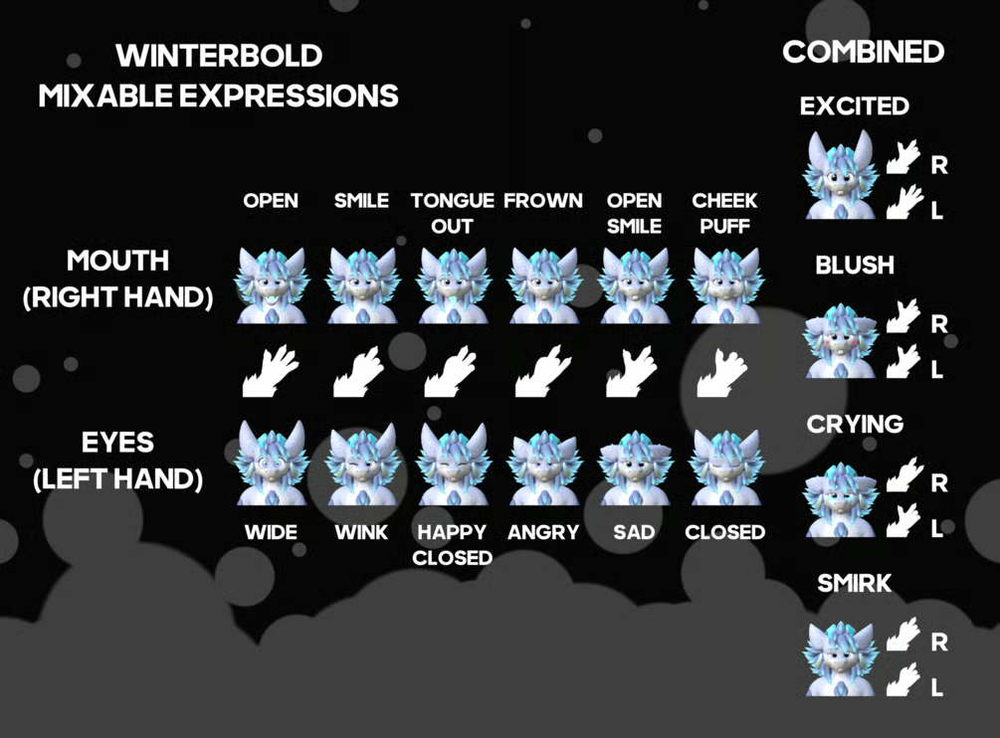

<!-- markdownlint-disable MD033 -->

# Winterbold Avatar

<!-- panels:start -->

<!-- div:title-panel -->

## Credits

<!-- div:right-panel -->

`v1.2.0-R1.0`

- Avatar Import: **Axiom Wolf**
- Coordination and Docs-Refactor: **Phil**

<!-- div:left-panel -->

> [!Note]
> This is a community port to Resonite. **Do not contact Guusy for technical support**, as they will be unable to help you with your issue. If you find any bugs or inconsistencies, please reach out to AxiomWolf(`@unskilledwolf`) on Discord.

<!-- panels:end -->

## Use Guide

### Basic Setup

To start using the Winterbold right away without any customizations, hold the "Finish Avatar" button. Thats it!

### Custom Textures

1. Import your textures to Resonite by dragging and dropping the files into the game.
1. Switch to the "Textures"-tab
1. Hold the texture with one hand
1. Primary click on the texture you want to replace

On Desktop, you need to laser-grab with holding left-click and right-click on the texture you want to replace.

### Core Add-On

The Winterbold Core add-on comes pre-installed with the avatar and is fully customizable through the context menu. This allows for expressions, based on the VRC hand-gestures and community made addons.

### Improving Avatar Performance

- You can improve performance by disabling addon-features are you don't need.
- It is recommended for knowledgeable users to bake any unused blendshapes to greatly reduce load times for the avatar. The body's mesh is located in `/CenteredRoot/Renderers/Body`. Keep in mind that this may limit the ability to add clothing options in the future.
- By default textures have a 4K resolution, and can be downscaled through the Asset Optimization Wizard, available from the dev tool. This saves on inventory space and reduces memory usage.

<!-- panels:start -->

<!-- div:title-panel -->

### Controls

<!-- div:left-panel -->

#### VR Controls

<!-- div:right-panel -->

#### Desktop controls

- <kbd>Keypad0</kbd>: Eyes Wide
- <kbd>Keypad1</kbd>: Eyes Happy (Closed)
- <kbd>Keypad2</kbd>: Wink
- <kbd>Keypad3</kbd>: Eyes Sad
- <kbd>Keypad4</kbd>: Eyes Closed
- <kbd>Keypad5</kbd>: -
- <kbd>Keypad6</kbd>: Eyes Angry
- <kbd>Keypad7</kbd>: Mouth Open
- <kbd>Keypad8</kbd>: Tongue Out
- <kbd>Keypad9</kbd>: Smile
- <kbd>KeypadDivide</kbd>: Open Smile
- <kbd>KeypadMultiply</kbd>: Cheek Puff
- <kbd>KeypadMinus</kbd>: -
- <kbd>KeypadPlus</kbd>: Frown

<!-- panels:end -->

## Technical Documentation

This avatar follows the [Avatar Standard](https://wiki.resonite.com/Avatar_standard) (up to spec as of January 2026).

Most expression and personalization functionality is self-contained in the Core Add-On. It is possible to uninstall and re-install this system at any time. The avatar contains several DynamicValueVariableDrivers that listen to values set by this module.

### Non-Standardized variables

To overwrite an eye to open in the EyeManager, use the following variables. Using these instead of Blendshapes fixes for "double blinking" where multiple eyes closed blendshapes are active at once.

- float `Avatar/EyeManager.EyeCloseOverride.Left`
- float `Avatar/EyeManager.EyeCloseOverride.Right`
- bool `Avatar/EyeManager.DisableBlinking`
- string `Avatar/version`

### Avatar Specific Variables

These blendshapes trigger custom effects on the avatar. These variables are only provided by the core addon. However, variables marked with `◂` are listened to as drivers.

#### Tail

- float `Avatar/Tail.WagSpeed`
- float `Avatar/Tail.Puppet` The direction is is being dragged
- bool `Avatar/Tail.Puppet` If puppeting is enabled
- ◂ floatQ `Avatar/Tail.Rotation`

#### Toes

- ◂ float `Avatar/Toes.Curl.Left`
- ◂ float `Avatar/Toes.Curl.Right`
- bool `Avatar/Toes.Puppet` If puppeting is enabled

#### Ears

- bool `Avatar/Ears.Puppet`
- float `Avatar/Ears.Deflect` The total target sideways movement of the ears
- float `Avatar/Ears.Back` The total target backwards movement of the ears
- ◂ float `Avatar/Ears.Deflect.Left` The actual sideways movement on the left side
- ◂ float `Avatar/Ears.Back.Left` The actual backwards movement on the left side
- ◂ float `Avatar/Ears.Deflect.Right` The actual sideways movement on the right side
- ◂ float `Avatar/Ears.Back.Right`
  - The actual backwards movement on the right side. The ear directions also have an overwrite variant that is driven by the expression manager. The is combined with the total values and then sent back to the avatar by the sided values.

#### Headpats

- bool `Avatar/Headpats.LocalTrigger` If the local user is triggering the headpats
- bool `Avatar/Headpats.Sound.Enabled`
- bool `Avatar/Headpats.Trigger` If any user is headpatting
- bool `Avatar/Headpats.Enabled` If the headpats are enabled

#### Eyes

- bool `Avatar/EyePoking.Enabled`
- int `Avatar/Eyes.Pupil.Type`
- bool `Avatar/Eyes.DisableBlinking` If blinking is toggled off on the avatar (combined with expressions and set to the EyeManager's variable)

#### Expressions

- bool `Avatar/Expressions.Locked.Mouth`
- bool `Avatar/Expressions.Locked.Eyes`
- bool `Avatar/Expressions.Disabled.Mouth`
- bool `Avatar/Expressions.Disabled.Eyes`

#### Tongue

- bool`Avatar/Tongue.Puppet`
- ◂ bool `Avatar/Tongue.Phyiscs`
- ◂ float `Avatar/Tongue.Out`
- ◂ floatQ `Avatar/Tongue.Puppet` The actual rotation of the tongue bone

#### Body

- ◂ bool `Avatar/DynamicBoneChain.Butt.Enabled`
- ◂ bool `Avatar/DynamicBoneChain.Breasts.Enabled`
- ◂ colorX `Avatar/Material.Fur.EmissiveColor`
- ◂ colorX `Avatar/Material.Misc.EmissiveColor`

#### Clothing

- bool `Avatar/BaseClothes.WearMittens`

### Blendshapes

Only a subset of Blendshapes are available as dynamic variables. The rest can be either reserved or baked for performance. Keep in mind that some may be used in the future for clothes compatibility.

- bool `Avatar/Blendshape.Body_Breasts`
- bool `Avatar/Blendshape.Body_Feminine`
- bool `Avatar/Blendshape.FingerClaws_Retract`
- bool `Avatar/Blendshape.ToeClaws_Retract`
- float `Avatar/Blendshape.Teeth_Sharp`
- bool `Avatar/Blendshape.Teeth_Fangs`
- bool `Avatar/Blendshape.Eyelashes_Feminine`
- float `Avatar/Blendshape.Jaw_Open`
- float `Avatar/Blendshape.Mouth_Smile.L`
- float `Avatar/Blendshape.Mouth_Smile.R`
- float `Avatar/Blendshape.Mouth_Blep`
- ~~float `Avatar/Blendshape.Tongue_Out`~~ Use Avatar/Tongue.Out for dynamic bone compatibility.
- float `Avatar/Blendshape.Mouth_Frown.L`
- float `Avatar/Blendshape.Mouth_Frown.R`
- float `Avatar/Blendshape.Mouth_Puff.L`
- float `Avatar/Blendshape.Mouth_Puff.R`
- float `Avatar/Blendshape.Eyebrows_Raised.L`
- float `Avatar/Blendshape.Eyebrows_Raised.R`
- float `Avatar/Blendshape.Eyes_Wide.L`
- float `Avatar/Blendshape.Eyes_Wide.R`
- float `Avatar/Blendshape.Eyes_HappyClosed.L`
- float `Avatar/Blendshape.Eyes_HappyClosed.R`
- float `Avatar/Blendshape.Eyebrows_Lowered.L`
- float `Avatar/Blendshape.Eyebrows_Lowered.R`
- float `Avatar/Blendshape.Eyebrows_Cross.L`
- float `Avatar/Blendshape.Eyebrows_Cross.R`
- float `Avatar/Blendshape.Nose_Scrunch.L`
- float `Avatar/Blendshape.Nose_Scrunch.R`
- float `Avatar/Blendshape.Pupils_Small`
- float `Avatar/Blendshape.Eyebrows_Drooped.L`
- float `Avatar/Blendshape.Eyebrows_Drooped.R`
- float `Avatar/Blendshape.Eyes_LowerRaise.L`
- float `Avatar/Blendshape.Eyes_LowerRaise.R`
- float `Avatar/Blendshape.Lips_Pull.L`
- float `Avatar/Blendshape.Lips_Pull.R`
- float `Avatar/Blendshape.Show_Tears`
- float `Avatar/Blendshape.Show_Blush`
- float `Avatar/Blendshape.Pupils_Wide`
- float `Avatar/Blendshape.Pupils_Slit`
- float `Avatar/Blendshape.Pupils_Goat`
- float `Avatar/Blendshape.Pupils_Heart`
- float `Avatar/Blendshape.Pupils_Star`
- bool `Avatar/Blendshape.Ears_Notched`
- bool `Avatar/Blendshape.Hide_BaseClothes_Charms`
- bool `Avatar/Blendshape.Hide_BaseClothes_WaistHoodie`
- bool `Avatar/Blendshape.Hide_BaseClothes_Warmers`

